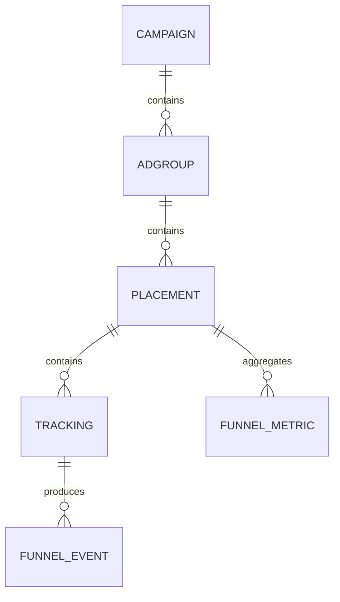

# 현재 구조 분석과 새 실험의 계약

## 저장소에서 실제로 연결된 경로

| 영역 | 입력 → 저장 → 조회 | 이번 실험과 관계 |
|---|---|---|
| Spring push-click-service | HTTP controller → service → JDBC repository → Distributed push/click → local ReplicatedMergeTree → MV → ReplicatedAggregatingMergeTree → campaign/hour View | 실행 가능한 별도 앱. placement/tracking 모델이 아님 |
| Kafka 실험 | Redpanda → Kafka 엔진 → MV → 대상 테이블 | 소비·재시도·poison pill 실험. 쇼핑몰 데이터 생성기와 자동 연결되지 않음 |
| 쇼핑몰 standalone | 정규화된 event → MergeTree → recent MV / first-event MV → AggregatingMergeTree → 일반 View | 수집 완료 이벤트부터 실행. 최초 수집 시각과 큰 argMin tuple 유지 |
| A2/A4 | Distributed → ReplicatedMergeTree → local MV → ReplicatedAggregatingMergeTree → argMinMerge | product/journey/stage 키를 병합하고 대표 이벤트를 확정. 장기 상태 스캔 비용 발생 |
| A3 | 공통 event → 쿼리 중 argMin → 시간·고객 그룹 집계 | 별도 상태 저장 없이 조회 CPU/메모리로 비용 이동 |
| A5/A6 | summary 경로 비교 | 새 브랜치 기준 main에서는 설계 문서. 실제 A5/A6 구현·실측은 이전 PR 브랜치에 있음 |
| A7 | 이벤트별 ReplacingMergeTree → 상태/보정 summary | main의 설계 제안. 실행 DDL 없음 |

`docs/architecture.md`의 shop_web_log, notification_raw, shop_link_log, journey_map, 규칙 평가 JOIN은 상위 참고 구조입니다. 해당 그림 전체가 배포·실행됐다고 해석하면 안 됩니다. 이번에도 Kafka·HTTP 성능을 event INSERT 성능과 혼합하지 않습니다.

## 기존 min/argMin이 유지하는 정보

standalone은 `(journey_id, event_kind)`에 대해 `min(received_at)`과 `argMinState(tuple(mall_id,store_id,product_id,customer_group_ids,occurred_at,received_at,source_kind,message_id), tuple(received_at,message_id))`를 저장합니다. 클러스터 구현은 product를 정렬 키 앞에 두어 상품 조건을 먼저 적용합니다.

이 비용에는 키 수에 따른 GROUP BY 해시 테이블, tuple의 배열·문자열, 저장된 여러 부분 상태의 최종 병합, background AggregatingMergeTree 병합이 들어갑니다. `min()` 한 개의 비교 비용만으로 설명할 수 없습니다. 반대로 scalar 최소시각 상태도 key당 행과 merge가 필요하므로 무료가 아닙니다.

새 Baseline은 기존과 같은 최초 수집/동률 계약으로 큰 tuple을 보존하고, synthetic attributes 약 130바이트를 더해 넓은 상태의 부담을 측정합니다. 따라서 운영 tuple 크기의 실측 대체값은 아닙니다. Case A는 `min(event_datetime)`만 남긴 간소화 모델입니다. tuple 크기뿐 아니라 분리 테이블/MV 수도 달라 완전한 한 변수 실험은 아닙니다.

## 새 도메인과 계층

20 campaign × 10 adgroup × 10 placement = 2,000 placement를 생성합니다. tracking의 약 20%가 placement 1에 집중되고 나머지가 1,999 placement에 분산됩니다. tracking별 4 stage를 각각 4회 기록하므로 전체 행의 75%가 placement/tracking/stage 누적 unique 기준 반복입니다. 실제 단계 이탈률 대신 각 stage에 동일 부하를 주는 통제 데이터입니다.

단계는 LANDING/OPEN/CLICK/CONVERSION을 새로 명시적으로 생성합니다. 쇼핑몰 NOTIFY는 SEND와 유사하지만 이번 범위에서 제외합니다. VIEW와 LANDING/OPEN, CART와 CLICK을 동일한 이벤트라고 선언하지 않습니다. 운영 매핑은 업무 정의 후 별도 확정해야 합니다.

## 비교안

| 안 | 상세 저장 | 추가 상태 | 서비스 지표의 의미 |
|---|---|---|---|
| raw_unique | 통합 funnel_event | 없음 | 기간 내 unique tracking |
| raw_window_argmin | 통합 funnel_event | 쿼리 중 큰 tuple GROUP BY | 기간 안에서 dedup한 unique tracking, raw_unique와 같아야 함 |
| argmin_first_received | 통합 funnel_event | min + 큰 argMinState | 전체 이력의 최초 수집 대표가 기간에 귀속되는 수 |
| tracking_first_event | stage별 MergeTree | scalar min tracking state | 전체 이력의 최초 발생이 기간에 귀속되는 수 |
| tracking_snapshot | 위와 같음 | 최초 발생 state에서 snapshot metric 생성 | tracking_first_event와 같아야 함 |
| combined / exact / bitmap | stage별 MergeTree | 1m → 1h unique states | 기간 내 unique tracking |

Case A의 `funnel_tracking_state → metric`은 immutable snapshot을 읽어 빈 metric에 한 번만 적재합니다. 이 작업의 시간·CPU·메모리는 `operation=snapshot`으로 별도 측정합니다. `min` 변경을 새 INSERT block만 보는 MV로 정확히 증분 전달할 수 있다고 가정하지 않습니다.

## Raw → Event → Metric

공통 `raw`는 배치 번호와 정규화된 synthetic event를 저장합니다. 이 공통 읽기 비용은 모든 INSERT 측정에 포함됩니다. DB별 `ingress ENGINE=Null`은 이미 내구성 있게 저장된 raw를 4개 event 테이블로 라우팅하는 입력 단자입니다. Null 테이블을 운영의 유일한 raw 저장소로 제안하는 것이 아닙니다. Raw 저장 공간은 안별 저장량에서 제외하고 동일한 upstream 비용으로 취급합니다.

Event를 `(placement_id,event_datetime,tracking_id)`로 정렬해 placement IN + 시간 범위를 먼저 줄입니다. campaign/adgroup은 placement에 고정되므로 event 정렬 키 앞에 중복으로 넣지 않습니다. stage별 테이블이므로 event_type 정렬도 불필요합니다. month partition은 2년 보관을 24개 정도의 시간 단위로 관리하기 위한 후보입니다.

1m과 1h는 AggregatingMergeTree이며 1h MV는 `...MergeState`를 사용합니다. cascade는 삽입 block을 전달합니다. 이후 background merge를 다시 전달할 필요가 없는 이유는 state union이 결합 가능하고 반복 합집합이 결과를 바꾸지 않기 때문입니다. `countState/sumState`로 같은 효과를 얻는 것은 아닙니다.

## 조회 의미와 시간 경계

기간 내 unique와 최초 발생 귀속이 같아지는 것은 해당 tracking의 반복이 기간 경계를 넘지 않는 경우뿐입니다. 예시 A가 12:01·12:30·13:05 클릭했다면 12~13시 unique 1, 13~14시 unique 1, 12~14시 unique도 1입니다. 최초 발생 지표라면 13~14시는 0입니다.

최종 지표는 시간별 숫자의 합이 아니라 요청 범위 전체의 state union입니다. 서로 다른 placement의 tracking은 별도 집계하고, 같은 placement의 여러 campaign/adgroup 상태도 최종 placement 단위로 merge합니다.

`[12:30:01, 13:06:00)`처럼 정각에 맞지 않는 조회는 완전히 포함된 시간만 1h state로 읽고 나머지를 raw event에서 State로 만듭니다. 완전한 시간이 없는 짧은 범위는 상세 event만 읽습니다. 초·밀리초 경계까지 정확성을 유지하는 기본 구현이며, 향후 분 경계를 이용하는 1h+1m+event 세 단계 최적화는 별도입니다. 자세한 정합성 검사는 `verify.py`에 있습니다.

## 후보별 제약

- `uniqCombined64`: 대규모 distinct에서 근사값. cardinality가 작을 때와 클 때 state 표현이 다릅니다. 모든 bucket이 고정 작은 HLL 크기라고 용량을 산정하지 않습니다.
- `uniqExact`: unique key에 비례해 상태가 커지고 merge/query 메모리를 사용합니다. 정확하지만 24개월 상태 전체를 한 번에 합치는 비용을 따로 검증해야 합니다.
- `groupBitmap`: UInt64 무충돌 ID 계약에서 exact. ID 값의 분포에 따라 압축과 메모리가 크게 달라집니다. String을 임의 hash하면 무충돌 보장은 없어집니다. `state_probe.py`는 조밀한 ID와 UInt64 위에서 일대일 대응하는 산술 순열 ID를 비교합니다.
- SummingMergeTree 숫자 합산: 요청 기간을 넘어 같은 tracking이 나타날 수 있어 주 후보에서 제외합니다. upstream dedup도 각 bucket 안에서만 보장한다면 충분하지 않습니다.

## 측정 범위와 다음 단계

최초 실행은 한 Pod의 비복제 엔진 비교입니다. 다른 Pod와 같은 로컬 VM/디스크를 공유하므로 고립된 물리 서버 결과가 아닙니다. CPU threads=2, query memory=1.5GB는 query 한도이며 전체 프로세스·background merge RSS 한도가 아닙니다.

월 10억 event는 30일 균등 분포로 평균 약 386 event/s입니다. 실제 피크·재시도·MV fan-out·복제·late arrival 처리량은 이 평균으로 결정할 수 없습니다. 24개월 약 240억 상세 event를 보관할 때 raw/event 중복 저장, 1m/1h state, 3중 복제, merge 임시 공간, 백업, 재백필 공간을 함께 산정해야 합니다.

운영 후속 실험: 실제 tracking cardinality/ID 분포, 24개월 보존 밀도, 여러 IN 집합(분산 전용/인기 placement 혼합), 동시 조회·적재, replication/Distributed overhead, 특정 shard 장애·복구, 리플레이, MV 일부 실패 후 reconciliation, TTL 경계와 보정, 실제 SLO 기준 검증.

## 공식 문서

- [Aggregate function combinators](https://clickhouse.com/docs/reference/functions/aggregate-functions/combinators)
- [Cascading materialized views](https://clickhouse.com/docs/concepts/features/materialized-views/cascading-materialized-views)
- [uniqCombined64](https://clickhouse.com/docs/reference/functions/aggregate-functions/reference/uniqcombined64)
- [groupBitmap](https://clickhouse.com/docs/reference/functions/aggregate-functions/reference/groupbitmap)

문법과 동작은 문서 확인 외에도 현재 서버에서 DDL 적용과 결과 비교로 검증합니다.
